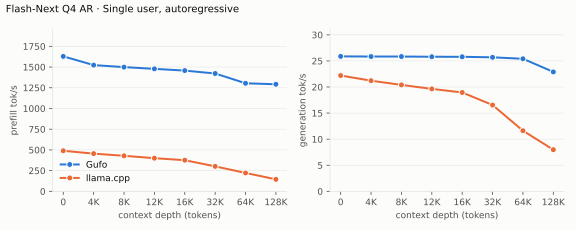
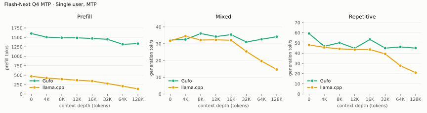

# Qwen3.8 Flash-Next benchmarks

AMD Strix Halo `gfx1151`, 128 GB unified memory. Unsloth `UD-Q4_K_XL` target and
shared-Q8_0 MTP sidecar; Gufo uses adaptive MTP. HTTP, greedy, thinking off.
Gufo: October 10, 2026, production Nix review build `25cdb2a1` of PR #518.
Reference results remain unchanged from September 22–23.
llama.cpp uses `b11069` for AR and `6fcaa16f` for MTP.

Positive gain favors Gufo.
[Quality and measurement details](QUALITY.md#benchmark-method) · [Model identities](artifacts/model-identities.json)

Gufo numerical regression checks pass; two focused functional phases still
exceed the timing gate. Historical llama.cpp MTP values are retained as requested:
a separate check of that pin did not match its own AR output, so this review
does not requalify those comparisons. [Review evidence](artifacts/decode-kernels-review.json).

## Single user, autoregressive

Approximately pp2048 / tg128; depth is the cached prefix in tokens.
Context capacities differ between engines; see the measurement details.

<!-- bench:single-ar -->
| Flash-Next Q4 AR Depth (tokens) | Gufo pp (tok/s) | llama.cpp pp (tok/s) | Gain | Gufo tg (tok/s) | llama.cpp tg (tok/s) | Gain |
| ---: | ---: | ---: | ---: | ---: | ---: | ---: |
| 0 | 1702.93 | 489.59 | +247.8% | 27.98 | 22.20 | +26.0% |
| 4,096 | 1624.56 | 455.24 | +256.9% | 28.27 | 21.21 | +33.3% |
| 8,192 | 1619.43 | 428.85 | +277.6% | 28.26 | 20.40 | +38.5% |
| 12,288 | 1606.91 | 400.21 | +301.5% | 28.21 | 19.64 | +43.6% |
| 16,384 | 1589.06 | 375.89 | +322.7% | 28.16 | 18.95 | +48.6% |
| 32,768 | 1556.91 | 301.31 | +416.7% | 28.02 | 16.54 | +69.4% |
| 65,536 | 1464.69 | 221.94 | +559.9% | 27.76 | 11.62 | +138.9% |
| 131,072 | 1430.01 | 144.78 | +887.7% | 27.13 | 7.98 | +240.0% |
<!-- /bench -->

## Single user, MTP

pp is the highest measured rate per engine and depth across mixed/repetitive
text, including Gufo predictor catch-up.

<!-- bench:single-mtp -->
| Flash-Next Q4 MTP Depth (tokens) | Gufo pp (tok/s) | llama.cpp pp (tok/s) | Gain pp | Gufo tg mixed (tok/s) | llama.cpp tg mixed (tok/s) | Gain mixed | Gufo tg repetitive (tok/s) | llama.cpp tg repetitive (tok/s) | Gain repetitive |
| ---: | ---: | ---: | ---: | ---: | ---: | ---: | ---: | ---: | ---: |
| 0 | 1627.98 | 468.76 | +247.3% | 33.80 | 31.73 | +6.5% | 65.25 | 48.12 | +35.6% |
| 4,096 | 1583.15 | 423.79 | +273.6% | 35.57 | 34.48 | +3.2% | 62.41 | 45.71 | +36.5% |
| 8,192 | 1575.39 | 394.98 | +298.9% | 35.08 | 32.20 | +8.9% | 52.98 | 44.31 | +19.6% |
| 12,288 | 1550.63 | 365.91 | +323.8% | 37.50 | 32.32 | +16.0% | 45.36 | 43.53 | +4.2% |
| 16,384 | 1504.60 | 341.98 | +340.0% | 38.01 | 32.07 | +18.5% | 54.12 | 43.66 | +24.0% |
| 32,768 | 1485.94 | 277.61 | +435.3% | 36.88 | 25.41 | +45.1% | 48.38 | 39.28 | +23.2% |
| 65,536 | 1412.16 | 208.04 | +578.8% | 36.29 | 19.65 | +84.7% | 47.23 | 27.75 | +70.2% |
| 131,072 | 1396.97 | 135.42 | +931.6% | 35.77 | 14.63 | +144.5% | 47.95 | 20.96 | +128.8% |
<!-- /bench -->

## Multiple users, autoregressive

Same pp2048 prose prompt as single-user d0, tg128, context 4096 per user.
All sessions prefilled before timed decoding; throughput sums individual rates.
llama.cpp re-evaluates its four-token checkpoint tail.

<!-- bench:multi-ar -->
| Flash-Next Q4 AR Users | Gufo AR (tok/s) | llama.cpp AR (tok/s) | Gain |
| ---: | ---: | ---: | ---: |
| 1 | 28.17 | 22.34 | +26.1% |
| 2 | 50.19 | 37.08 | +35.4% |
| 4 | 84.72 | 54.82 | +54.5% |
| 6 | 105.97 | 65.34 | +62.2% |
| 8 | 122.48 | 68.79 | +78.0% |
<!-- /bench -->

## Multiple users, MTP

Same pp2048 mixed/repetitive prompts as single-user d0, tg128, context 4096
per user. All sessions prefilled before timed decoding; rates sum individual
request decode rates. C1 cross-checks the single-user table.

<!-- bench:multi-mtp -->
| Flash-Next Q4 MTP Users | Gufo mixed (tok/s) | llama.cpp mixed (tok/s) | Gain | Gufo repetitive (tok/s) | llama.cpp repetitive (tok/s) | Gain |
| ---: | ---: | ---: | ---: | ---: | ---: | ---: |
| 1 | 33.37 | 31.77 | +5.0% | 64.92 | 46.93 | +38.3% |
| 2 | 57.20 | 42.79 | +33.7% | 93.02 | 52.57 | +76.9% |
| 4 | 83.99 | 48.78 | +72.2% | 146.39 | 48.23 | +203.5% |
| 6 | 105.52 | 52.59 | +100.6% | 166.28 | 48.51 | +242.8% |
| 8 | 121.15 | 61.92 | +95.7% | 184.74 | 58.13 | +217.8% |
<!-- /bench -->

## Single user, DFlash2 and MTP

October 21, 2026, Unsloth `UD-IQ4_XS` target, two-bank NPU prefill, `gufo bench`
(`-p 2048,16384 -n 128`, one run per cell; pp16384 at depth 0 is the mean of three
runs, because the first cell of a cold process includes kernel loading). DFlash2 uses
`Qwen3.8-Flash-Next-DFlash2-Q8_0.gguf`, MTP the shared Q8_0 sidecar. Decode on
the synthetic benchmark prompt depends on acceptance and is not comparable across rows;
real-text decode is in the [README](../../../README.md#qwen38-flash-next).

| Depth (tokens) | DFlash2 pp2048 | DFlash2 pp16384 | MTP pp2048 | MTP pp16384 |
| ---: | ---: | ---: | ---: | ---: |
| 0 | 1,466 | 2,142 | 1,609 | 2,098 |
| 32,768 | 1,481 | 2,043 | 1,461 | 1,997 |
| 131,072 | 1,415 | 1,920 | 1,459 | 1,885 |

pp2048 is below the 8192-token minimum of the paired-bank mode, so it reads the same
expert weights for a quarter of the tokens. A 65-request server suite
(greedy, thinking off) gives cold prefill of 1,918 to 1,953 tok/s for 22K to 60K prompts
and 1,927 tok/s at 112K on an idle machine.

## Loading time

C1, context capacity 262144, MTP. Cold target/sidecar files to HTTP readiness.

<!-- bench:loading -->
| Flash-Next Q4 Target | Gufo ready (s) | llama.cpp ready (s) | Gain |
| --- | ---: | ---: | ---: |
| Q4 | 14.94 | 117.83 | +688.7% |
<!-- /bench -->

## Memory occupation

C1, context capacity 133121, AR. Peak memory reported by HIP.

<!-- bench:memory -->
| Flash-Next Q4 AR Workload | Gufo GiB | llama.cpp GiB | Gain |
| --- | ---: | ---: | ---: |
| pp2048 + tg128 | 86.18 | 84.84 | -1.6% |
| 16K prefix, pp4096 + tg128 | 87.34 | 85.31 | -2.3% |
<!-- /bench -->

Latest (NPU on, fabric clock held, quiet machine): p=4096 1901, p=6144 1823 (bench
cannot use the NPU on its partial group), p=8192 1966–2009, p=12288 1972–1977,
p=16384 1953–1969, p=32768 1934. In the server, prompts that are not multiples of 4096 prefill on the GPU alone.
Prefill speed depends on the text: a
concatenation of code and markdown prefilled 20–30% slower than code alone at the
same length because expert routing differs.

## Notes moved from the README speed section

A `-c` above the native 262,144 extends the model to a **1,048,576-token context**
with YaRN automatically. That full-prompt row above is a real 1,048,044-token
request served end to end in 641.7 s, decoding at 33.7 tok/s with DFlash2
(46% draft acceptance). At cached depths, `gufo bench -d` decode reaches
106.8 tok/s at 524,288 (`-n 512`) and 72.9 at 983,040 (`-n 1024`).

The DFlash2 column was re-measured with the confidence cut described under
speculative decoding (greedy, the project's probe prompts: 4 code, 6 prose and the
JSON request). The plain and MTP columns come from an earlier prompt set, so read
differences under about 5% as noise. DFlash2 also skips the MTP head's prompt
priming, which is why its prefill is about 3% faster. Math prompts decode at
about 95 tok/s and copy-heavy prompts at about 127 tok/s.

Grammar-constrained turns (tool calls) decode at 90 to 93 tok/s, up from 59 to 61
before their draft verification stayed on the GPU.

Prompt passes of 1,024 to 4,095 tokens (short prompts and the tail of a long one)
also run on the NPU, through the runtime-M program: prefill is +1% to +5% from
about 3,000 tokens upward and unchanged below, and the text matches the previous
build on 27 of 28 regression prompts (the other is a paraphrase at a near tie).

`gufo bench -n 96`: 35.9 tok/s plain, 54.2 tok/s with MTP (on the benchmark's
own repetitive context, where drafts are accepted easily).

In the two-bank NPU mode the prefill residual stays in F16, worth about 1.5%
(+0.5% perplexity); `GUFO_F16_RESIDUAL=0` keeps it in F32 (about 2,085 tok/s at
`-p 16384`). GPU-only prefill stays exact. The first NPU run after the machine
has been idle can be much slower, so discard it when benchmarking.

Prefill depends on the text as well as the length: code, markdown and prose
route to experts differently, so the same length can vary by 20% or more.
